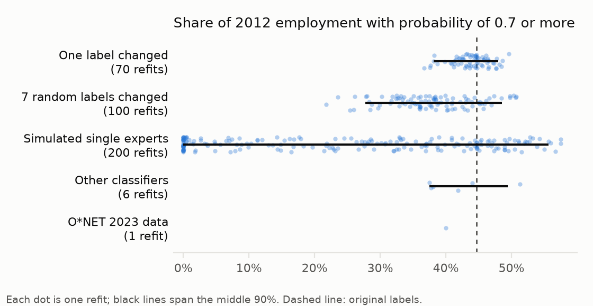
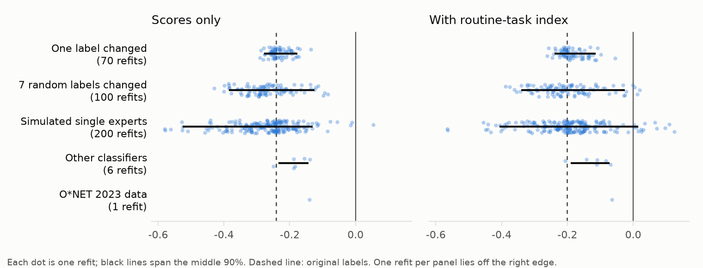
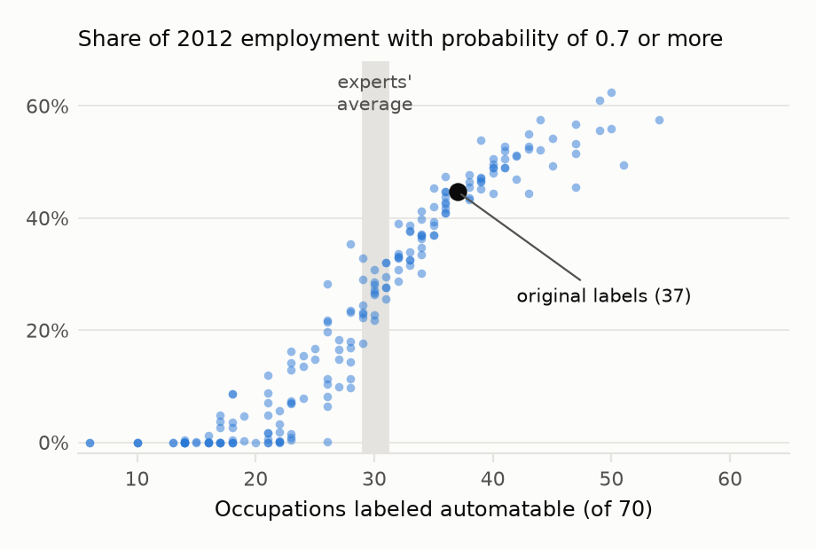

# autoscores: How much do 70 hand labels decide the Frey–Osborne automation scores?

Frey and Osborne (2017) trained a Gaussian-process classifier on 70 occupations that they labeled
by hand as automatable or not, and used it to score 702 US occupations. Their finding that 47% of
US employment is at high risk of automation, and the scores themselves, are used widely in
economics, sociology and public health. This repository refits their classifier from public files
and asks how much the scores change when the hand labels, the classifier or the O*NET data change.

Pilot for the Yale workshop *AI for Social Science Research Methods* (April 2027). Extended abstract:
[`paper/abstract.tex`](paper/abstract.tex) (Markdown version: [`paper/abstract.md`](paper/abstract.md)).





## Results
| change | share of 2012 employment with probability ≥ 0.7 |
|---|---|
| none (our refit; published scores give 44.5%) | 45% |
| one label changed (each of 70) | 37% to 50% |
| a random 60 of the 70 labeled (200 refits) | 39% to 50% |
| 7 random labels changed (100 refits) | 28% to 49% |
| 7 "automatable" labels changed to "not" (100 refits) | 19% to 36% |
| simulated single experts from Walsh (2018) (200 refits) | 0% to 56%; 27% at the experts' average |
| other classifiers (6) | 37% to 51% |
| O*NET 2023 data in place of 2012 | 40% |

Ranges with 100+ refits are the middle 90%.

1. The high-risk share depends on a few labels. Relabeling one occupation, claims adjusters, as not
   automatable moves retail salespersons, the largest occupation, from 0.92 to 0.38. Classifiers that
   predict held-out labels equally well (AUC 0.85 to 0.91) give shares from 37% to 51%.
   Across simulated experts, the share follows how many of the 70 are labeled automatable (rank
   correlation 0.97): at the experts' average of 29 to 31, it is 27% (Figure 2).
2. When 7 random labels change, 53% of employment is in occupations whose 90% interval contains 0.7.
3. The ordering is steadier. In 846 of 848 refits, occupations with higher scores lost employment
   between 2012 and 2023 (ACS). With a routine-task control the slope stays negative in 98% of refits but
   is more than two standard errors below zero in 57%.



Full numbers: [`results/summary.md`](results/summary.md).

## Design
- **Data** (public, no registration):
  - Frey & Osborne working paper (2013), appendix: 702 probabilities and the 70 hand labels
  - O*NET 17.0 (July 2012) and 28.0 (August 2023): the nine variables in Frey & Osborne's Table I
  - ACS 1-year PUMS, 2012 and 2023: civilian employment by occupation
- **Refit:** scikit-learn Gaussian-process classifier with a squared-exponential kernel and one
  length scale per variable. It matches the published probabilities at r = 0.99.
- **Changes:** each label reversed in turn (70); 3 or 7 random labels reversed (100 each); 7 random
  "automatable" labels set to "not", matching the lower counts in Walsh's (2018) expert survey (100);
  200 simulated single experts, each drawing a count of "automatable" labels from Walsh's reported
  distributions (robotics 29.0 ± 10.1, AI 31.1 ± 10.8), with the fewest label changes that reach it;
  a random 60 of the 70 labels (200); each label left out (70); six other classifiers; O*NET 2023 inputs.
- **Measures:** employment share with probability ≥ 0.7; each occupation's 90% interval across
  refits; slope of log employment change 2012–2023 (and 2012–2019) on probability across 406
  occupation groups that can be followed across the 2018 SOC revision, with and without a routine-task
  index (Acemoglu & Autor 2011) built from the same O*NET release.

## Reproduce
Requires Python 3.12. About 5 minutes on 4 CPU cores after the downloads (1.9 GB, mostly ACS PUMS for 2012, 2019 and 2023).
No GPU or API keys.
```bash
python -m venv .venv && source .venv/bin/activate
pip install -r requirements.txt
bash scripts/reproduce.sh
```
To skip the PUMS downloads, use the shipped employment tables in `data/`:
```bash
python scripts/get_data.py --no-pums
python -m autoscores.run && python -m autoscores.analyze && python -m autoscores.figure
```

## Layout
| Path | What |
|---|---|
| `scripts/get_data.py` | downloads inputs and parses the Frey–Osborne appendix |
| `autoscores/features.py` | the nine O*NET variables by SOC code |
| `autoscores/employment.py` | ACS employment by occupation → `data/emp_acs{2012,2019,2023}.csv` |
| `autoscores/link.py` | links SOC codes to ACS codes and across the 2018 SOC revision |
| `autoscores/run.py` | all refits → `results/probs.csv`, `results/runs.csv`; held-out AUC → `results/auc.csv` |
| `autoscores/analyze.py` | `results/summary.md`, `results/shares.csv`, `results/table1.csv` |
| `autoscores/figure.py` | `results/figure1.png` (share), `figure2.png` (share vs. label count), `figure3.png` (employment slope) |
| `paper/` | extended abstract (.tex and .md) |

## Limitations
1. Employment comes from the ACS, not the BLS 2010 data Frey and Osborne used; with the published
   scores this gives 44.5% instead of 47%. Where one ACS code covers several occupations, its
   employment is split equally among them.
2. Walsh (2018) reports how many occupations each group called automatable, not each expert's labels,
   so the simulation chooses at random which labels change and makes only the fewest changes that reach
   each count. A second, independent set of labels would measure disagreement directly.
3. Frey and Osborne describe a horizon of "a decade or two"; the 2012–2023 change checks only
   whether the ordering of occupations carries information.
4. The refit uses scikit-learn's Laplace approximation, not the expectation propagation of the
   original GPML code (r = 0.99 with the published scores; held-out AUC 0.87 vs 0.89).

## Data
Raw data are not redistributed; `scripts/get_data.py` fetches them from the original sources.
- Frey, C. B., & Osborne, M. A. (2013). The future of employment. Oxford Martin School working paper.
- National Center for O*NET Development. O*NET 17.0 and 28.0 databases. onetcenter.org (CC BY 4.0).
- U.S. Census Bureau. American Community Survey 1-year PUMS, 2012, 2019 and 2023.

## License
Code: MIT (see `LICENSE`).
