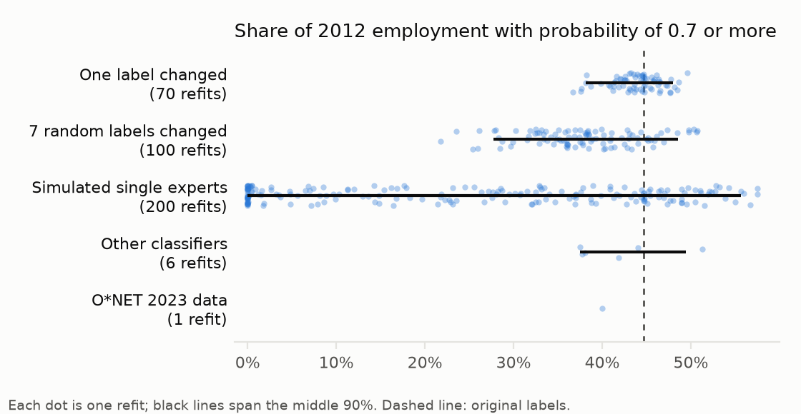
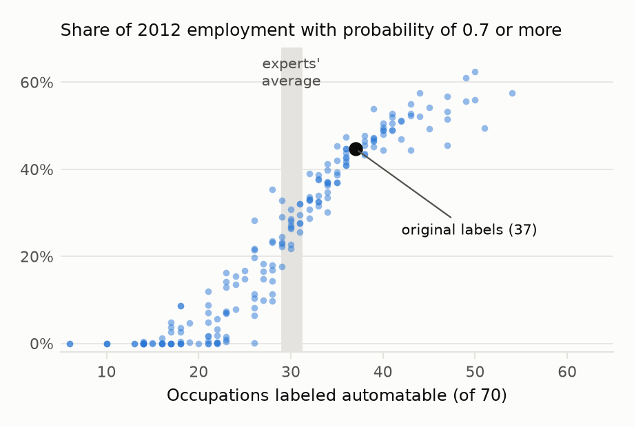
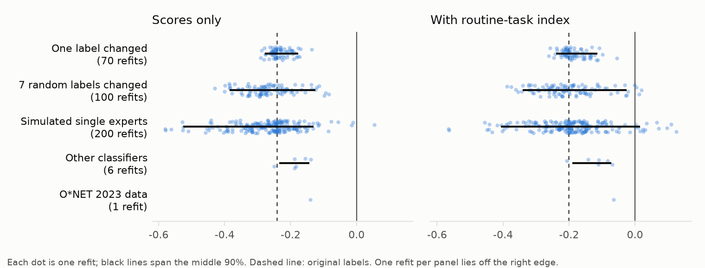

# Do the Frey–Osborne Automation Scores Depend on Their Hand Labels?

*Nyx(ius) Labs. Extended abstract, AI for Social Science Research Methods, Yale University, April 2027.*
*Markdown copy of `abstract.tex`; the .tex file is the submission version.*

**Abstract.** Frey and Osborne estimated that 47% of US employment is at high risk of automation. The estimate comes from a classifier trained on 70 occupations that they labeled by hand, and they argued that small changes to those labels would not change it much. We refit the classifier from public files and changed the labels. Reversing a single label moves the estimate anywhere from 37% to 50%. The estimate mostly follows how many of the 70 occupations are labeled automatable. If that number matches what AI and robotics experts chose on average in a later survey, the estimate falls to about 27%. The order of occupations changes much less, and occupations ranked higher did lose employment after 2012. Scores built from a few hand labels are safer to use as a ranking than as a count of jobs above a cutoff.

## Introduction

Social scientists often build a measure by labeling a few cases by hand and training a classifier to score the rest. The labels are judgments, so the measure carries them. Authors usually check how well the classifier predicts labels it did not see. That check tells us whether the classifier learned the labels. It does not tell us how much the measure would change if the labels had been different.

Frey & Osborne (2017) are the best-known case. With a group of machine-learning researchers, they labeled 70 occupations as automatable or not, trained a Gaussian-process classifier on nine O*NET variables, and scored all 702 detailed occupations. Occupations with a probability of 0.7 or more held 47% of US employment. The authors say plainly that this is the share of jobs that the technology they foresaw could automate, not a forecast: they "make no attempt to estimate how many jobs will actually be automated." The scores are now used as variables in studies of health (Patel et al. 2018), local labor markets (Frank et al. 2018) and wages (Fossen & Sorgner 2022). To check the labels, Frey and Osborne trained the classifier on half of them and predicted the other half. The fit was good, and they concluded that "slight modifications to this set are unlikely to lead to substantially different results."

We test that sentence on its own terms: same classifier, same data, same 0.7 cutoff, different labels. The results build in four steps. The share at high risk moves with single labels (Section 3.1). It moves mainly with how many occupations are labeled automatable (3.2). As a result, for about half of employment an occupation's side of the cutoff depends on the labels (3.3). The order of occupations depends on them much less, and it predicts later employment change (3.4).

Earlier work changed other parts of the design (Arntz et al. 2016; Lorenz et al. 2023; Coelli & Borland 2019). Corrections for error in machine-learned variables need a random sample of cases with known true values (Egami et al. 2023; Battaglia et al. 2024), and none can exist when the labels are forecasts. Instead, we refit the classifier with other plausible labels and carry each refit through the analysis (Knox et al. 2022).

## Data and methods

**Data.** All inputs are public. The appendix of Frey & Osborne (2013) lists each occupation's probability and the 70 hand labels (37 automatable). The nine input variables come from O*NET 17.0 (2012), the first release coded to the 2010 occupation codes. Employment comes from American Community Survey (ACS) microdata for 2012, 2019 and 2023. As in Autor & Dorn (2013), we use the ACS for its large samples and consistent occupation codes; we follow 406 occupation groups across the 2018 revision of the codes.

**Refit.** We fit a Gaussian-process classifier with one length scale per variable (Rasmussen & Williams 2006). Our probabilities correlate with the published ones at 0.99. With ACS employment, the published scores put 44.5% of employment at high risk, close to the 47% Frey and Osborne found with BLS data.

**Changes.** Each change keeps everything else as in the original:

- *One label:* each of the 70 labels reversed in turn. This is the smallest change to the labels there is.
- *Seven labels:* 7 of the 70 (10%) reversed at random, 100 times.
- *Simulated experts:* Walsh (2018) asked about 300 AI and robotics experts to label the same 70 occupations. On average they called 29 to 31 automatable, against 37, with a standard deviation of about 10. He reports these counts but not each expert's labels. We draw 200 counts from his reported distributions and, for each, make the fewest label changes that reach it.
- *Classifier and data:* six other classifiers, and O*NET 28.0 (2023) in place of 17.0.

These are 377 refits. The code holds 470 more with other label changes (labels left out, three reversed, seven "automatable" set to "not"); they give the same picture.

**Measure.** For each refit we compute the share of 2012 employment with probability 0.7 or more. We keep 0.7 because it defines the 47% figure; the ranking results in Section 3.4 use no cutoff.

## Results

### One label moves the share

Figure 1 shows the high-risk share in every refit. Reversing one label moves it between 37% and 50%, and reversing seven moves it between 28% and 49% (middle 90%). The other classifiers predict held-out labels about as well as the original (area under the curve 0.85 to 0.91), yet give shares from 37% to 51%; the 2023 O*NET data give 40%. Good prediction of held-out labels therefore does not pin down the share.

*Figure 1. Share of employment at high risk under each change.*

The reason lies in how the labels were chosen. Frey and Osborne labeled the occupations they were most sure of, which sit at the two ends of the scale. Most classifiers implicitly assume that the labeled cases are a random sample of all cases (Grimmer & Stewart 2013); these are not. Many large occupations lie between labeled occupations of opposite kinds, so a single label can move the classifier's boundary across them. Relabeling claims adjusters as not automatable lowers the score of retail salespersons, the largest occupation, from 0.92 to 0.38. A held-out check compares labeled occupations with one another, so it cannot detect this.

### The number of automatable labels sets the share

The widest row in Figure 1 is the simulated experts. Figure 2 shows why: their share rises with the number of occupations they label automatable, with a rank correlation of 0.97. With Frey and Osborne's 37, the share is 45%. With the experts' average of 29 to 31, the median is 27%.

*Figure 2. Share at high risk and the number of occupations labeled automatable.*

Fewer automatable labels should give fewer high-risk jobs. What matters is the size of the effect: removing a fifth of the automatable labels removes about two fifths of the share. The 47% figure therefore reflects, above all, how often the labelers said "automatable".

### Half of employment is near the cutoff

If the share moves this much, so does the class of single occupations. When 7 random labels change, 53% of 2012 employment is in occupations whose 90% interval across refits contains 0.7. Table 1 shows the ten largest occupations. For six of them, one changed label is enough to move the score across 0.7.

| Occupation | Employment 2012 (m) | Published score | One label changed (range) | 7 labels changed (middle 90%) |
|---|---|---|---|---|
| Retail salespersons | 3.5 | 0.92 | 0.38–0.94 | 0.38–0.87 |
| Supervisors of retail sales workers | 3.0 | 0.28 | 0.02–0.44 | 0.05–0.47 |
| Customer service representatives | 2.5 | 0.55 | 0.35–0.84 | 0.24–0.76 |
| Waiters and waitresses | 2.2 | 0.94 | 0.71–0.96 | 0.67–0.90 |
| Accountants and auditors | 2.1 | 0.94 | 0.83–0.95 | 0.64–0.92 |
| Laborers and freight movers, hand | 2.0 | 0.85 | 0.61–0.91 | 0.50–0.88 |
| Construction laborers | 1.6 | 0.88 | 0.50–0.96 | 0.47–0.89 |
| Stock clerks and order fillers | 1.6 | 0.64 | 0.30–0.91 | 0.36–0.89 |
| Maids and housekeeping cleaners | 1.5 | 0.69 | 0.45–0.92 | 0.46–0.85 |
| Postsecondary teachers | 1.4 | 0.03 | 0.03–0.15 | 0.07–0.37 |

*Table 1. Scores of the ten largest occupations when labels change.*

### The ranking holds

While the labels set the level of the scores, the O*NET variables largely set their order. The median rank correlation with the original scores is 0.98 when one label changes, and 0.86 for the simulated experts and for the other classifiers.

The order also carries information. Frey and Osborne call the probability "a rough timeline", with high scores expected to go first. So we ask only whether higher-ranked occupations lost employment, not whether 47% of jobs disappeared. Figure 3 (left) shows the slope of log employment change from 2012 to 2023 on the score, across the 406 occupation groups. With the original labels, an occupation scored 1 grew about 24 log points less than one scored 0 (standard error 0.07). The slope is negative in 846 of all 848 refits, and in 843 when the window ends in 2019, before the pandemic.

*Figure 3. Slope of 2012–2023 log employment change on the score, without and with a routine-task index.*

Adding a routine-task index (Acemoglu & Autor 2011) asks a different question: whether the scores carry information beyond routine work (Simonsohn et al. 2020). Figure 3 (right) gives the answer. The slope stays negative in 98% of refits but is more than two standard errors below zero in only 57%. Whether the scores add to a routine-task index thus depends on the labels. Coelli & Borland (2019) found that the published scores added little beyond routine tasks in 2013–2018.

## Limits

Our experts are simulated from Walsh's counts, so we choose at random which labels change. Because the share depends mostly on the count, we expect a panel of actual expert labels to change our results mainly through that count; we plan to collect one. Where one ACS code covers several occupations, we split its employment equally among them. We approximate the classifier with Laplace's method rather than the original expectation propagation; the scores still match at 0.99.

## Conclusion

For the Frey–Osborne scores, the hand labels set the level and the O*NET variables set the order. The 47% figure and the class of many large occupations depend on the labels; the ranking depends on them much less. Users of such scores can treat them as a ranking rather than as a count above a cutoff, and can report results across refits with changed labels. A good fit on held-out labels shows that a classifier learned its labels, not that the measure would hold under different ones. Code and the refit scores for every occupation: <https://github.com/brandonyee-cs/autoscores>.

*Requested format: lightning talk or talk; poster acceptable.*

## References

- Acemoglu, D., & Autor, D. (2011). Skills, tasks and technologies: Implications for employment and earnings. In *Handbook of Labor Economics*, Vol. 4B, 1043–1171. Elsevier.
- Arntz, M., Gregory, T., & Zierahn, U. (2016). The risk of automation for jobs in OECD countries: A comparative analysis. OECD Social, Employment and Migration Working Papers No. 189.
- Autor, D.H., & Dorn, D. (2013). The growth of low-skill service jobs and the polarization of the US labor market. *American Economic Review*, 103(5), 1553–1597.
- Battaglia, L., Christensen, T., Hansen, S., & Sacher, S. (2024). Inference for regression with variables generated by AI or machine learning. arXiv:2402.15585.
- Coelli, M., & Borland, J. (2019). Behind the headline number: Why not to rely on Frey and Osborne's predictions of potential job loss from automation. Melbourne Institute Working Paper No. 10/19.
- Egami, N., Hinck, M., Stewart, B.M., & Wei, H. (2023). Using imperfect surrogates for downstream inference: Design-based supervised learning for social science applications of large language models. *Advances in Neural Information Processing Systems*, 36.
- Fossen, F.M., & Sorgner, A. (2022). New digital technologies and heterogeneous wage and employment dynamics in the United States: Evidence from individual-level data. *Technological Forecasting and Social Change*, 175, 121381.
- Frank, M.R., Sun, L., Cebrian, M., Youn, H., & Rahwan, I. (2018). Small cities face greater impact from automation. *Journal of the Royal Society Interface*, 15(139), 20170946.
- Frey, C.B., & Osborne, M.A. (2013). The future of employment: How susceptible are jobs to computerisation? Oxford Martin School working paper.
- Frey, C.B., & Osborne, M.A. (2017). The future of employment: How susceptible are jobs to computerisation? *Technological Forecasting and Social Change*, 114, 254–280.
- Grimmer, J., & Stewart, B.M. (2013). Text as data: The promise and pitfalls of automatic content analysis methods for political texts. *Political Analysis*, 21(3), 267–297.
- Knox, D., Lucas, C., & Cho, W.K.T. (2022). Testing causal theories with learned proxies. *Annual Review of Political Science*, 25, 419–441.
- Lorenz, H., Stephany, F., & Kluge, J. (2023). The future of employment revisited: How model selection affects digitization risks. *Empirica*, 50(2), 323–350.
- Patel, P.C., Devaraj, S., Hicks, M.J., & Wornell, E.J. (2018). County-level job automation risk and health: Evidence from the United States. *Social Science & Medicine*, 202, 54–60.
- Rasmussen, C.E., & Williams, C.K.I. (2006). *Gaussian Processes for Machine Learning*. MIT Press.
- Simonsohn, U., Simmons, J.P., & Nelson, L.D. (2020). Specification curve analysis. *Nature Human Behaviour*, 4(11), 1208–1214.
- Walsh, T. (2018). Expert and non-expert opinion about technological unemployment. *International Journal of Automation and Computing*, 15(5), 637–642.
